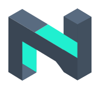
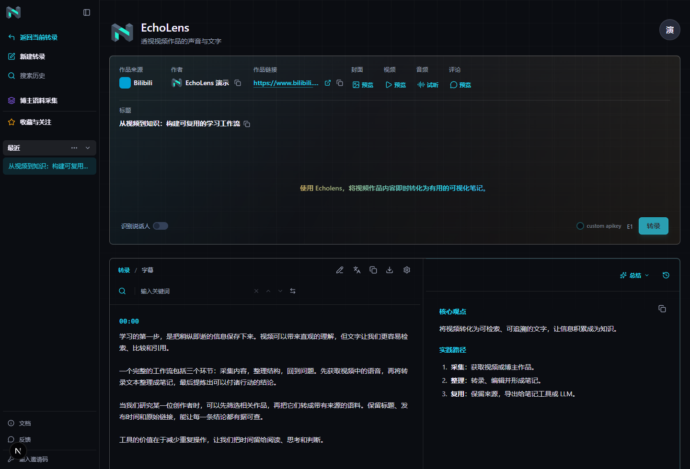
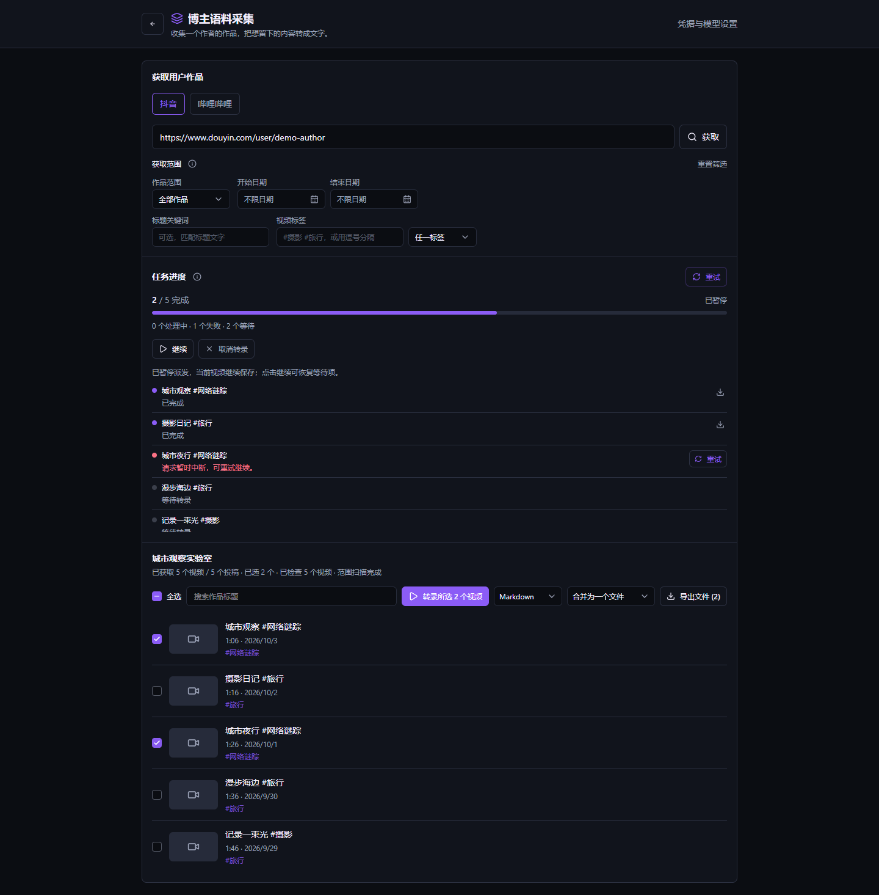
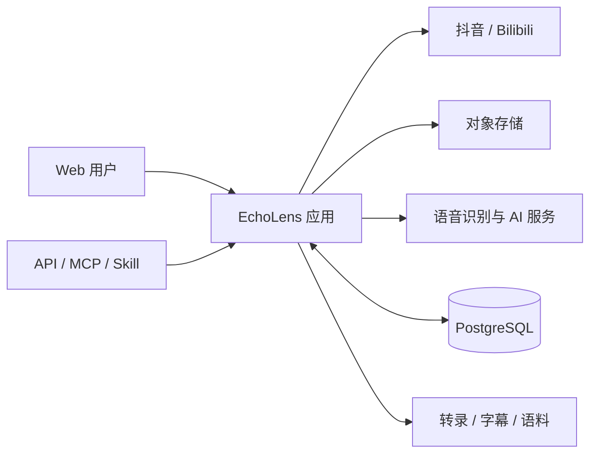
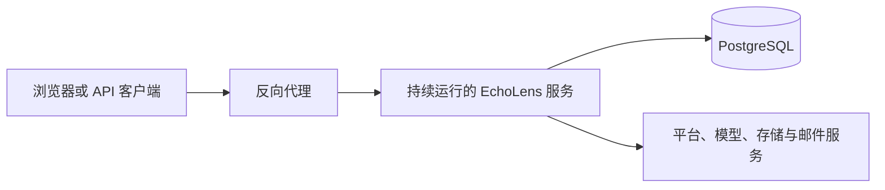

<div align="center">



# EchoLens

**把视频变成可编辑、可检索、可复用的文字与笔记。**

支持抖音与 Bilibili · 视频解析 · 语音转录 · AI 总结与翻译

[](package.json)
[](LICENSE.md)

[功能](#功能) · [快速开始](#快速开始) · [工具集成](#工具集成) · [架构与部署](#架构与部署) · [许可](#许可)



<sub>界面截图使用演示数据。</sub>

</div>

## 功能

| 想要做什么 | EchoLens 可以帮你 |
| --- | --- |
| 了解视频内容 | 粘贴分享链接或 BV 号，解析作品信息并获取可用媒体 |
| 整理语音内容 | 生成、搜索和编辑转录文本与字幕，支持说话人标记和多种格式导出 |
| 提炼与翻译 | 基于转录生成总结、翻译或其他内容，管理常用提示词 |
| 研究创作者 | 获取可见作品，按日期、关键词或标签筛选，批量转录并导出语料 |
| 继续此前的工作 | 查看和管理历史记录，暂停、继续或重试批量任务 |
| 接入自己的工具 | 通过 API、CLI、MCP 或 Skill 使用媒体解析和转录能力 |

<details>
<summary><strong>查看博主语料采集界面</strong></summary>



输入博主主页链接，获取作品后筛选并选择需要转录的视频。完成的内容可单独或合并导出。截图使用演示数据。

</details>

## 快速开始

本地运行需要 **Node.js 22.3 或更高版本、npm 和 PostgreSQL**。转录需要配置模型服务和对象存储；邮箱注册需要配置 SMTP。各服务的使用可能产生费用。

### 1. 获取项目

```powershell
git clone https://github.com/zhanpoint/EchoLens.git
Set-Location EchoLens
npm ci
Copy-Item .env.example .env
```

### 2. 配置服务

根据 [.env.example](.env.example) 编辑 `.env`，配置数据库、SMTP、DashScope 和 OSS。为 `AUTH_SESSION_SECRET`、`AUTH_EMAIL_CODE_SECRET` 和 `DATA_ENCRYPTION_KEY` 分别设置独立的随机密钥，每个至少 32 个字符。

当前模型接口地址需自托管者在 [模型配置](src/lib/dashscope/fixed-config.ts) 中替换为自己控制台提供的地址；API Key、地域和模型权限须匹配。平台账号功能可能需要额外的权限和有效凭据。

### 3. 启动

```powershell
npm run dev
```

打开 [localhost:3000](http://localhost:3000)，注册并登录。在「设置」中配置所需凭据，然后粘贴视频链接，解析后开始转录。数据库表由应用自动迁移。

Windows 可使用已安装的 Edge；其他环境可运行 `npx playwright install chromium` 安装浏览器。已有 PostgreSQL 服务即可直接使用，无需单独启动容器。

## 工具集成

在「设置 → API 访问令牌」创建令牌，即可通过 HTTP 接口调用媒体解析和转录能力，也可以使用 [MCP 服务](packages/echolens-mcp/bin/echolens-mcp.mjs)接入支持 MCP 的客户端。接口、CLI、MCP 和 Skill 的使用说明见运行中的 [应用文档](http://localhost:3000/docs)。

## 架构与部署

### 架构概览



### 部署概览



生产环境需要持久化数据库并做好备份，代理应允许长请求。批量任务需要持续运行的服务。容器部署入口见 [Dockerfile](Dockerfile) 和 [deploy/compose.yml](deploy/compose.yml)；配置项以 [.env.example](.env.example) 为准。

## 常见问题

- **收不到验证码**：检查 SMTP 账号、授权密码、发件地址和连接设置。
- **转录失败**：检查模型服务地址、API Key、模型权限和 OSS 配置。
- **无法获取平台内容**：检查账号权限和平台凭据；可获取范围也受平台限制。
- **批量任务暂停**：检查提示中的凭据或额度问题，处理后继续或重试。

## 参与贡献

欢迎通过 [Issues](https://github.com/zhanpoint/EchoLens/issues) 反馈问题或讨论需求，也欢迎提交 Pull Request。开发流程见 [CONTRIBUTING.md](CONTRIBUTING.md)。

## 许可

本项目采用 [PolyForm Noncommercial 1.0.0](LICENSE.md)，允许协议范围内的非商业使用、研究和修改，不授权商业用途。该许可不是 OSI 认可的开源许可证；第三方依赖遵循各自协议。

Required Notice: Copyright 2026 zhanpoint.
